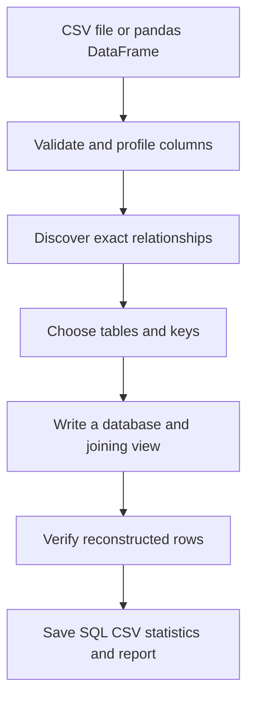

# How AutoSchema Converts CSV Data into SQL Tables

Bismillah. AutoSchema turns a CSV file or pandas DataFrame into related SQL tables, then checks that joining those tables reconstructs the normalized input exactly. It helps you inspect repeated data, discover possible relationships, and query the result with SQL. The current library is version 0.3.0.

## The basic idea

Imagine an orders CSV repeats a customer’s name and city on every order line:

| Order | Line | Customer | Name | City | Quantity |
| --- | --- | --- | --- | --- | --- |
| O001 | 1 | C01 | Amina | Melbourne | 2 |
| O001 | 2 | C01 | Amina | Melbourne | 1 |
| O002 | 1 | C02 | Yusuf | Sydney | 3 |
| O003 | 1 | C01 | Amina | Melbourne | 4 |

If each customer ID always maps to the same name and city, those details can be stored once in a customer table. The order lines retain the customer ID, which connects each line to its customer. This is a functional dependency: `customer_id → customer_name, city`. The rows above illustrate the relationship; AutoSchema creates a dimension only when its observed savings justify the extra table.

The physical tables store the separated data. A SQL view named `dataset` joins them to present the original logical columns. You can query `dataset` without manually assembling the joins.

## How a conversion works



1. **Read and preserve values.** Validate headers and CSV field counts. Keep empty fields and text such as `NA`. Convert values to numeric types only when their text representation round-trips safely. A postcode such as `0300` remains text.

2. **Profile the data.** Count rows, duplicates, blank cells, and distinct values. Record inferred SQL types and numeric minimum, mean, and maximum values where applicable.

3. **Discover relationships.** Check whether one column, or a combination of columns, consistently determines other values. Conflicting mappings are excluded from exact dependencies.

4. **Choose a schema.** Move suitable repeated attributes into dimension tables using a bounded, greedy plan. Keep their join keys in the `records` fact table and select or validate a primary key.

5. **Write and verify SQL.** Create tables with primary and foreign keys, insert the rows, and build `dataset`. Compare its reconstructed rows with the normalized typed input, including duplicate multiplicities.

6. **Publish the result.** Build the database, exports, summary, and report in a staging directory. Publish the completed output directory after they succeed. Existing output files are not replaced.

## What keys mean

A **primary key** uniquely identifies a row in a table. A **foreign key** connects a row to a key in another table. A **composite key** uses multiple columns together.

For example, `order_id` repeats across an order’s lines, but `(order_id, line_number)` can uniquely identify each line. Inventory details may depend on `(product_id, warehouse_id)` because the same product can have a different storage location in each warehouse.

You can supply the domain key with `key_columns`. AutoSchema checks that it is unique and contains no blanks. If you leave it unset, the library searches for candidate keys and prefers identifier-like names over accidentally unique measurements.

## What the retail example produces

The included synthetic retail dataset has **4,800 rows and 23 columns**. Its saved example contains these six physical tables:

| Table | Rows | What it stores |
| --- | ---: | --- |
| `records` | 4,800 | Order lines, join keys, quantities, discounts, and delivery notes |
| `dim_customer_id` | 120 | Customer names, cities, and segments |
| `dim_product_id` | 60 | Product names, categories, brands, and listed prices |
| `dim_warehouse_id` | 4 | Warehouse names, cities, and postcodes |
| `dim_order_id` | 1,200 | Order dates, statuses, and sales channels |
| `dim_product_id_warehouse_id` | 240 | Storage locations and reorder points for each product and warehouse pair |

The `dataset` view reconstructs all **4,800 rows and 23 original columns**. The example reduces stored cells from **110,400 to 44,956**, a **59.28% reduction**. Stored cells count rows × columns across physical tables, including their keys; they measure repeated values removed, not bytes compressed.

## Use the Python library

From your repository folder, activate your virtual environment and install the package:

```bash
source .venv/bin/activate
python -m pip install -e .
```

Convert the included CSV into a new output directory:

```python
from autoschema import convert_csv

result = convert_csv(
    "data/retail_complex.csv",
    out="results/my-run",
    key_columns=["order_id", "line_number"],
)

stats = result.summary()
print(stats["table_rows"])
print(stats["reconstruction_exact"])
print(result.report_path)
```

Choose a fresh or empty output directory for every conversion.

Read the original logical structure or query it with SQL:

```python
rows = result.read_table()  # defaults to the dataset view
customers = result.read_table("dim_customer_id")

sales = result.query("""
    SELECT category, SUM(quantity) AS units
    FROM dataset
    GROUP BY category
    ORDER BY units DESC
""")
print(sales)
```

The query methods return pandas DataFrames and open a read-only database connection for each call.

To convert data already in pandas, call `convert_dataframe(frame, out="results/my-frame")`. Missing DataFrame values become empty strings and the input frame remains unchanged. To reopen saved results later:

```python
from autoschema import load_result

saved = load_result("results/my-run")
print(saved.query("SELECT COUNT(*) AS rows FROM dataset"))
```

Reopening checks saved metadata and database structure. It does not rerun inference or repeat the original input comparison.

## Find the output files

| File | How to use it |
| --- | --- |
| `dataset.sqlite` | Open the SQLite database to inspect actual tables and data |
| `dataset.duckdb` | Equivalent database when the optional DuckDB engine is selected |
| `schema.sql` | Read table and view definitions |
| `dataset.sql` | Restore the schema and data inserts into the selected database engine |
| `records.csv` and `dim_*.csv` | Open readable copies of each physical table |
| `schema.json` | Read the full statistics, inferred relationships, keys, timings, and warnings |
| `report.html` | Open the visual processing report in a browser |

The existing example is in `results/retail-demo/`. For a guided, executable walkthrough, open `notebooks/autoschema_walkthrough.ipynb` in Jupyter or VS Code, select the project’s Python environment, and run the cells in order. Its default output location is `results/notebook-runs/`.

## How to interpret the result

**Exact reconstruction concerns normalized values.** Duplicate row counts and original column order are retained. SQL row order, original CSV quoting, original file bytes, and arbitrary pandas dtypes are not preserved.

**Inferred relationships need domain review.** A pattern in one input file may not hold for future data. The planner is heuristic and does not guarantee an optimal schema. The default search considers determinants and keys up to two columns, prioritizes up to 30 candidate columns, and allows up to 2,000 candidate checks per search. The summary discloses search bounds and reached budgets.

**Cell reduction and file size answer different questions.** Use `cell_reduction_percent` for fewer repeated values, and `database_bytes` or `database_to_csv_ratio` for actual database storage. Database overhead can make a normalized database larger than its CSV. The size ratio excludes the extra export files.

**The current implementation needs the data to fit in memory.** Both conversion and exact reconstruction verification load data into RAM.

## Planned preview and review workflow

The proposed next version would separate analysis from database generation: preview the suggested tables, inspect the evidence for each relationship, adjust keys, accept or reject relationships, and then write SQL from the reviewed plan. This review API is planned; version 0.3.0 currently performs inference and database generation in one conversion call.

Alhamdulillah, you can already convert data, inspect statistics and reports, query the reconstructed dataset, and reopen saved results. The next step is making the inferred schema easier to review before conversion, insyallah.
